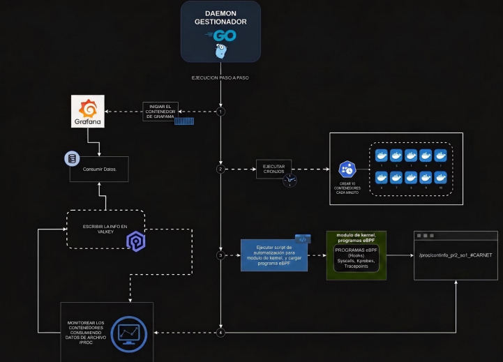
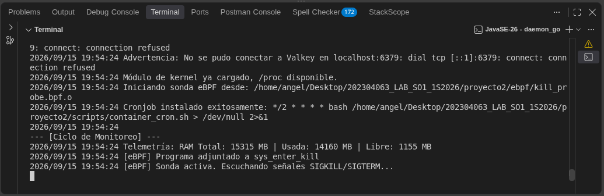
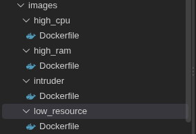
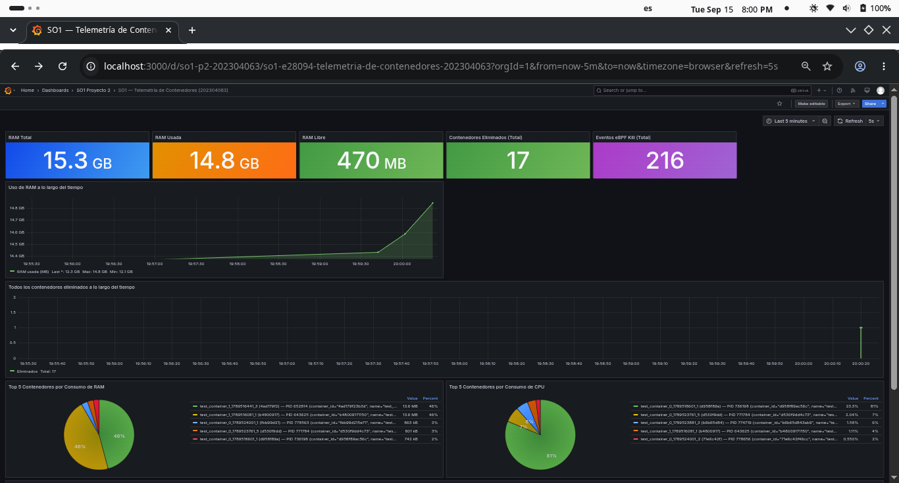
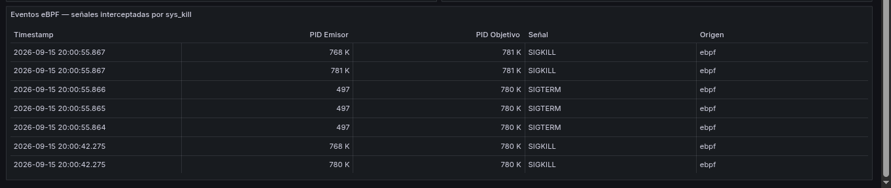
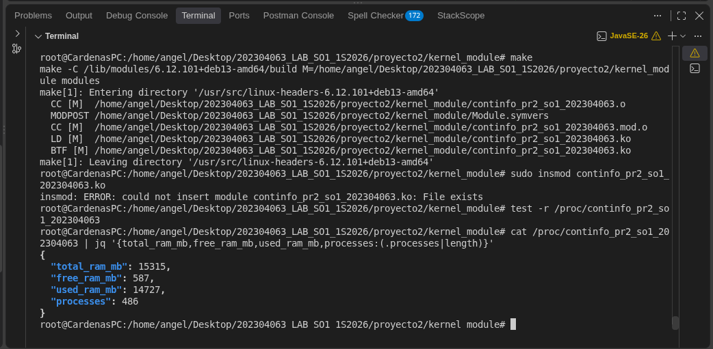
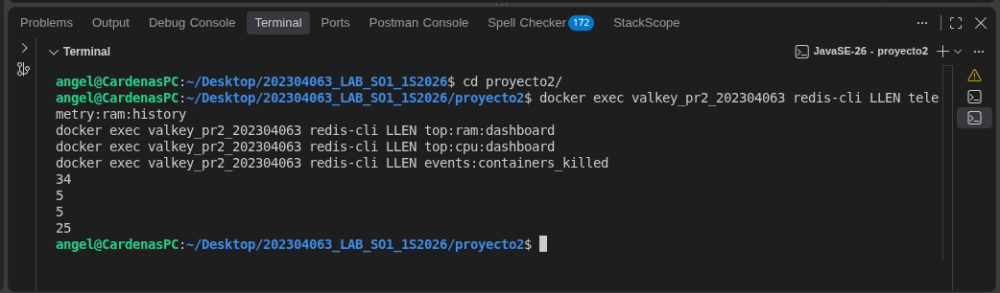
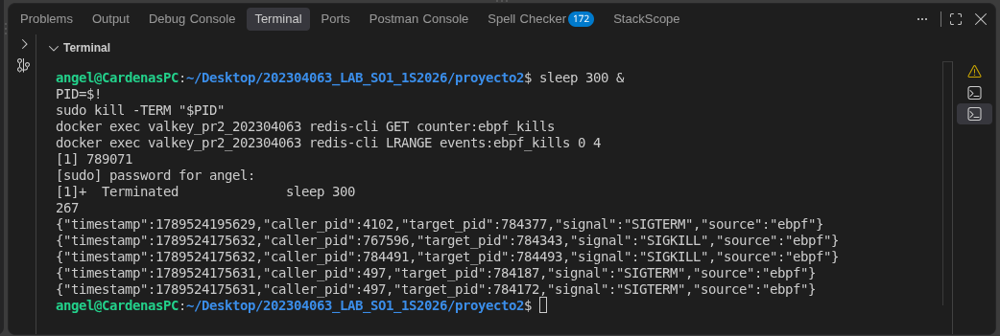

# Manual Técnico

**Estudiante:** Angel Jose Cardenas Pocon
**Carnet:** 202304063
**Curso:** Sistemas Operativos 1
**Semestre:** 2S 2026

---

# Proyecto 2 - Telemetría de contenedores

**Plataforma:** Linux, Docker, módulo de kernel en C, daemon en Go, eBPF,
Valkey y Grafana.

## 1. Resumen

Este proyecto implementa un sistema de observabilidad y gestión automática de
contenedores Docker. Un módulo de kernel en C expone información del sistema y
de sus procesos mediante `/proc`. Un daemon escrito en Go lee y deserializa
esa información, identifica los procesos de los contenedores, guarda métricas
en Valkey y toma decisiones para mantener la cantidad de contenedores
solicitada. Una sonda eBPF observa las llamadas `sys_kill` y registra los
eventos de terminación. Grafana consulta Valkey y presenta el estado actual,
las series históricas, los rankings y los eventos.

El proyecto se encuentra dentro de la carpeta `proyecto2` del repositorio del
Proyecto 1.

## 2. Objetivos

### 2.1 Objetivo general

Diseñar e implementar una solución de monitorización a nivel de kernel para
analizar y gestionar contenedores Linux, integrando C, Go, eBPF, Docker,
Valkey y Grafana.

### 2.2 Objetivos específicos

- Exponer memoria y procesos mediante un módulo de kernel en `/proc`.
- Obtener PID, nombre, VSZ, RSS, porcentaje de RAM y CPU de los procesos.
- Leer y deserializar la interfaz `/proc` desde Go.
- Crear contenedores de prueba automáticamente cada dos minutos.
- Mantener tres contenedores de bajo consumo y dos de alto consumo.
- Detectar y eliminar el contenedor intruso.
- Interceptar señales `SIGTERM` y `SIGKILL` mediante eBPF.
- Persistir métricas y eventos en Valkey.
- Visualizar los datos con un dashboard provisionado de Grafana.

## 3. Arquitectura



## 4. Estructura del proyecto

| Ruta                                                 | Responsabilidad                                      |
| ---------------------------------------------------- | ---------------------------------------------------- |
| `daemon_go/main.go`                                  | Daemon de monitorización, decisiones, Valkey y eBPF. |
| `daemon_go/go.mod`                                   | Dependencias y versión del módulo Go.                |
| `kernel_module/continfo_pr2_so1_202304063.c`         | Código del módulo de kernel.                         |
| `kernel_module/Makefile`                             | Compilación contra los headers del kernel activo.    |
| `ebpf/kill_probe.bpf.c`                              | Programa eBPF que observa `sys_enter_kill`.          |
| `ebpf/vmlinux.h`                                     | Definiciones BTF usadas por el programa eBPF.        |
| `ebpf/kill_probe.bpf.o`                              | Objeto eBPF cargado por el daemon.                   |
| `images/*/Dockerfile`                                | Imágenes locales para simular perfiles de consumo.   |
| `scripts/container_cron.sh`                          | Creación periódica de contenedores de prueba.        |
| `grafana/provisioning/dashboards/so1_dashboard.json` | Dashboard completo.                                  |
| `grafana/provisioning/dashboards/provider.yml`       | Provisioning del dashboard.                          |
| `grafana/provisioning/datasources/valkey.yml`        | Datasource Redis-Valkey.                             |
| `docker-compose.yml`                                 | Servicios Valkey y Grafana.                          |
| `comandos.md`                                        | Comandos rápidos de instalación y pruebas.           |

### Diagrama de las carpetas

```text
.
├── comandos.md
├── daemon_go
│ ├── daemon
│ ├── go.mod
│ ├── go.sum
│ └── main.go
├── docker-compose.yml
├── docs
│ ├── Documentacion.md
│ └── image
│ └── image.png
├── ebpf
│ ├── kill_probe.bpf.c
│ ├── kill_probe.bpf.o
│ └── vmlinux.h
├── grafana
│ └── provisioning
│ ├── dashboards
│ │ ├── provider.yml
│ │ └── so1_dashboard.json
│ └── datasources
│ └── valkey.yml
├── images
│ ├── high_cpu
│ │ └── Dockerfile
│ ├── high_ram
│ │ └── Dockerfile
│ ├── intruder
│ │ └── Dockerfile
│ └── low_resource
│ └── Dockerfile
├── kernel_module
│ ├── continfo_pr2_so1_202304063.c
│ ├── continfo_pr2_so1_202304063.ko
│ ├── .continfo_pr2_so1_202304063.ko.cmd
│ ├── continfo_pr2_so1_202304063.mod
│ ├── continfo_pr2_so1_202304063.mod.c
│ ├── .continfo_pr2_so1_202304063.mod.cmd
│ ├── continfo_pr2_so1_202304063.mod.o
│ ├── .continfo_pr2_so1_202304063.mod.o.cmd
│ ├── continfo_pr2_so1_202304063.o
│ ├── .continfo_pr2_so1_202304063.o.cmd
│ ├── Makefile
│ ├── .module-common.o
│ ├── ..module-common.o.cmd
│ ├── modules.order
│ ├── .modules.order.cmd
│ ├── Module.symvers
│ └── .Module.symvers.cmd
└── scripts
└── container_cron.sh


```

## 5. Requisitos

El sistema debe ejecutarse en Linux con permisos suficientes para leer el
archivo `/proc`, usar Docker, cargar módulos de kernel y ejecutar eBPF.

Requisitos principales:

- Docker Engine y Docker Compose.
- Headers del kernel activo y herramientas de compilación (`make`, `gcc`).
- Go 1.26.5 o una versión compatible con `go.mod`.
- Clang/LLVM con soporte para el target BPF.
- `bpftool` o una herramienta equivalente para generar/verificar BTF si es
  necesario.
- `cron` o `crond` habilitado.
- Permisos para ejecutar `sudo`, `insmod`, `rmmod` y eBPF.
- Conexión a internet durante el primer `docker compose up`, para descargar
  imágenes y dependencias.

## 6. Instalación y ejecución

Todos los comandos siguientes parten de la carpeta `proyecto2`.

### 6.1 Iniciar Valkey y Grafana

```bash
cd proyecto2
docker compose up -d
o docker compose up --build
docker compose ps
```

Los servicios quedan disponibles en:

- Grafana: `http://localhost:3000`
- Valkey: `localhost:6379`
- Usuario de Grafana: `admin`
- Contraseña inicial: `admin`

Grafana monta `grafana/provisioning` en el contenedor. El proveedor carga el
dashboard desde `so1_dashboard.json` y no permite que una edición manual en la
interfaz sustituya la versión versionada del repositorio.

### 6.2 Compilar el módulo de kernel

```bash
cd kernel_module
make
```

El resultado principal es:

```text
continfo_pr2_so1_202304063.ko
```

Para cargarlo manualmente:

```bash
sudo insmod continfo_pr2_so1_202304063.ko
cat /proc/continfo_pr2_so1_202304063
```

Para descargarlo:

```bash
sudo rmmod continfo_pr2_so1_202304063
```

El daemon también intenta cargar el módulo si no encuentra la interfaz
`/proc/continfo_pr2_so1_202304063`.

### 6.3 Compilar la sonda eBPF

```bash
cd ../ebpf
clang -O2 -g -target bpf -c kill_probe.bpf.c -o kill_probe.bpf.o
```

El archivo `kill_probe.bpf.o` debe encontrarse en `proyecto2/ebpf`, porque el
daemon lo busca usando la ruta relativa `../ebpf/kill_probe.bpf.o` desde
`daemon_go`.

### 6.4 Compilar y ejecutar el daemon

```bash
cd ../daemon_go
go build -o daemon .
sudo ./daemon
```

El daemon debe ejecutarse como una única instancia. Al iniciar realiza estas
acciones:

1. Se conecta a Valkey en `localhost:6379` o en la dirección definida por
   `VALKEY_ADDR`.
2. Inicializa los contadores principales con `SETNX`.
3. Comprueba si existe la interfaz `/proc` y carga el módulo si hace falta.
4. Inicia la sonda eBPF.
5. Registra el cronjob de `container_cron.sh` cada dos minutos.
6. Ejecuta inmediatamente un ciclo de monitorización.
7. Repite el ciclo cada 20 segundos.

Para cambiar la dirección de Valkey:

```bash
VALKEY_ADDR=192.168.1.10:6379 sudo -E ./daemon
```

Al recibir `Ctrl+C`, `SIGTERM` o una señal de terminación equivalente, el
daemon elimina el cronjob que instaló antes de finalizar.



## 7. Módulo de kernel

El módulo crea el archivo:

```text
/proc/continfo_pr2_so1_202304063
```

La información se genera al leer el archivo; no se almacena permanentemente
en el módulo. Se utiliza `si_meminfo()` para la memoria global y se itera la
lista de procesos del kernel mediante `for_each_process()`.

### 7.1 Métricas globales

El objeto JSON contiene:

- `total_ram_mb` y `total_ram_kb`.
- `free_ram_mb` y `free_ram_kb`.
- `used_ram_mb` y `used_ram_kb`.

La memoria usada se calcula como:

```text
memoria usada = memoria total - memoria libre
```

### 7.2 Métricas por proceso

Cada proceso incluye:

- `pid`: identificador del proceso.
- `name`: nombre (`task->comm`).
- `vsz_kb`: tamaño de memoria virtual.
- `rss_kb`: memoria residente física.
- `ram_percent`: porcentaje de RAM calculado con RSS.
- `cpu_time_ms`: tiempo acumulado de CPU en milisegundos.

Ejemplo reducido de respuesta:

```json
{
  "total_ram_mb": 15315,
  "free_ram_mb": 3000,
  "used_ram_mb": 12315,
  "processes": [
    {
      "pid": 12345,
      "name": "client",
      "vsz_kb": 80000,
      "rss_kb": 14000,
      "ram_percent": 0.08,
      "cpu_time_ms": 1250
    }
  ]
}
```

El `cpu_time_ms` es acumulativo. El daemon calcula el porcentaje usado entre
dos ciclos de 20 segundos y lo normaliza por la cantidad de CPUs lógicas. En
el primer ciclo el porcentaje puede ser cero porque todavía no existe una
muestra anterior.

## 8. Cronjob e imágenes

El archivo `scripts/container_cron.sh` se ejecuta cada dos minutos. En cada
ejecución intenta crear:

- Cinco contenedores de trabajo, distribuidos aleatoriamente entre perfiles
  de consumo.
- Un contenedor intruso.

Las imágenes locales disponibles son:

| Dockerfile            | Perfil       | Comportamiento                             |
| --------------------- | ------------ | ------------------------------------------ |
| `images/high_cpu`     | Alto CPU     | Ejecuta cálculos repetitivos usando `bc`.  |
| `images/high_ram`     | Alto RAM     | Reserva aproximadamente 100 MB en Python.  |
| `images/low_resource` | Bajo consumo | Ejecuta `sleep` durante 240 segundos.      |
| `images/intruder`     | Intruso      | Intenta leer `/etc/shadow` periódicamente. |

Para construirlas manualmente:

```bash
docker build -t so1/high-cpu:local images/high_cpu
docker build -t so1/high-ram:local images/high_ram
docker build -t so1/low-resource:local images/low_resource
docker build -t so1/intruder:local images/intruder
```

La versión actual del script utiliza las imágenes `alpine`,
`roldyoran/go-client` y `roldyoran/intruder`, siguiendo las imágenes
recomendadas en el enunciado. Los Dockerfiles locales permiten ejecutar la
misma simulación sin depender de esas imágenes externas, pero deben sustituir
los nombres en el script si se desea utilizarlos directamente.

Para probar el script manualmente:

```bash
bash scripts/container_cron.sh
docker ps
```



## 9. Lógica del daemon

### 9.1 Recolección

En cada ciclo el daemon:

1. Lee y deserializa `/proc/continfo_pr2_so1_202304063`.
2. Guarda memoria global actual e historial de RAM en Valkey.
3. Ejecuta `docker ps` para conocer los contenedores activos.
4. Ejecuta `docker inspect` para obtener el PID de cada contenedor.
5. Cruza cada PID de Docker con la lista de procesos del módulo.
6. Ejecuta `docker stats --no-stream` para obtener CPU de Docker usada en las
   decisiones operativas.
7. Ordena los contenedores por RAM y por CPU del kernel.

### 9.2 Clasificación y restricciones

Grafana y Valkey se consideran contenedores del sistema y no participan en los
rankings ni en las eliminaciones automáticas.

Un contenedor se clasifica como de alto consumo si su imagen o nombre indica
un perfil alto, si usa más de `0.5%` de RAM o si `docker stats` reporta más de
`20%` de CPU. Los demás contenedores gestionables se consideran de bajo
consumo.

El daemon aplica estas reglas:

- Elimina inmediatamente los contenedores cuyo nombre o imagen contenga
  `intruder`.
- Conserva como máximo tres contenedores de bajo consumo.
- Conserva como máximo dos contenedores de alto consumo.
- Si hay más contenedores de una categoría, elimina los excedentes.
- Nunca elimina Grafana ni Valkey.

Cuando elimina un contenedor, ejecuta `docker rm -f`, registra el evento y
actualiza los contadores. Las listas de eventos se limitan a 500 registros
para evitar un crecimiento indefinido.

## 10. Sonda eBPF

La sonda está definida en `ebpf/kill_probe.bpf.c` y se adjunta al tracepoint:

```text
syscalls/sys_enter_kill
```

Solo conserva señales `SIGTERM` (`15`) y `SIGKILL` (`9`). Cada evento contiene:

- PID emisor.
- PID objetivo.
- Señal enviada.

Los eventos se colocan en un ring buffer BPF de 16 MB. El daemon obtiene el
mapa `events`, lee el ring buffer y guarda cada evento en
`events:ebpf_kills`. También incrementa `counter:ebpf_kills`.

La sonda requiere privilegios elevados. Si aparece `operation not permitted` o
un error relacionado con `MEMLOCK`, el daemon no puede crear el mapa BPF. En
ese caso debe ejecutarse con:

```bash
sudo ./daemon
```

El daemon intenta elevar automáticamente el límite `MEMLOCK`. Si ya había una
instancia antigua ejecutándose, es necesario detenerla y reiniciar el binario
recompilado; dos instancias pueden sobrescribir las mismas claves de Valkey.

### Nota sobre los eventos

El sistema conserva dos tipos de información relacionados pero separados:

- `events:containers_killed`: eliminación solicitada y ejecutada por el
  daemon, con `value: 1` para graficar cada evento.
- `events:ebpf_kills`: señales `SIGTERM` o `SIGKILL` observadas a nivel del
  kernel.

Esta separación permite diagnosticar tanto la acción administrativa como la
confirmación de la syscall. El contador eBPF representa señales interceptadas,
no necesariamente un conteo exacto de contenedores eliminados; una syscall
puede afectar a un proceso y no a todo el contenedor.

## 11. Modelo de datos en Valkey

| Clave                                       | Tipo       | Uso                                         |
| ------------------------------------------- | ---------- | ------------------------------------------- |
| `system:total_ram_mb`                       | String     | Total actual de RAM.                        |
| `system:ram_used_mb`                        | String     | RAM usada actual.                           |
| `system:ram_free_mb`                        | String     | RAM libre actual.                           |
| `system:containers_deleted_total`           | String     | Total de contenedores eliminados.           |
| `counter:ebpf_kills`                        | String     | Total de señales observadas por eBPF.       |
| `counter:containers_killed`                 | String     | Contador histórico de eliminaciones.        |
| `telemetry:ram:history`                     | List JSON  | Historial de RAM con timestamp real.        |
| `events:containers_killed`                  | List JSON  | Todos los eventos de eliminación retenidos. |
| `events:ebpf_kills`                         | List JSON  | Eventos de `sys_kill` retenidos.            |
| `top:ram:dashboard`                         | List JSON  | Hasta cinco contenedores con mayor RSS.     |
| `top:cpu:dashboard`                         | List JSON  | Hasta cinco contenedores con mayor CPU.     |
| `top:ram` / `top:cpu`                       | Sorted set | Rankings compatibles con Valkey.            |
| `telemetry:top5:ram` / `telemetry:top5:cpu` | Hash       | Datos de compatibilidad.                    |
| `telemetry:ram:used`                        | Stream     | Serie auxiliar de RAM usada.                |
| `telemetry:ram:free`                        | Stream     | Serie auxiliar de RAM libre.                |
| `telemetry:containers:deleted`              | Stream     | Serie auxiliar de eliminaciones.            |

Las listas JSON se utilizan en el dashboard porque cada elemento conserva su
timestamp y sus campos semánticos. Esto evita que la respuesta aplanada de
`XRANGE` o `ZRANGE` sea interpretada como una única columna ambigua.

## 12. Dashboard de Grafana

El dashboard tiene un rango predeterminado de `now-5m` a `now` y refresca cada
5 segundos. No utiliza el modo `streaming` para las series históricas.




### 12.1 Paneles

| Panel                             | Visualización          | Fuente                                 |
| --------------------------------- | ---------------------- | -------------------------------------- |
| RAM Total                         | Stat                   | `GET system:total_ram_mb`              |
| RAM Usada                         | Stat                   | `GET system:ram_used_mb`               |
| RAM Libre                         | Stat                   | `GET system:ram_free_mb`               |
| Contenedores eliminados total     | Stat                   | `GET system:containers_deleted_total`  |
| Eventos eBPF total                | Stat                   | `GET counter:ebpf_kills`               |
| Uso de RAM a lo largo del tiempo  | Time series            | `LRANGE telemetry:ram:history 0 199`   |
| Todos los contenedores eliminados | Time series con barras | `LRANGE events:containers_killed 0 -1` |
| Top 5 RAM                         | Pie chart              | `LRANGE top:ram:dashboard 0 4`         |
| Top 5 CPU                         | Pie chart              | `LRANGE top:cpu:dashboard 0 4`         |
| Eventos eBPF                      | Table                  | `LRANGE events:ebpf_kills 0 49`        |

La gráfica de RAM temporal utiliza únicamente `used_mb`, tal como solicita el
enunciado. La RAM libre se conserva como tarjeta de estado, pero no como una
gráfica temporal adicional.

## 13. Pruebas y evidencias

### 13.1 Prueba del módulo

```bash
cd proyecto2/kernel_module
make
sudo insmod continfo_pr2_so1_202304063.ko
test -r /proc/continfo_pr2_so1_202304063
cat /proc/continfo_pr2_so1_202304063 | jq '{total_ram_mb,free_ram_mb,used_ram_mb,processes:(.processes|length)}'
```

La evidencia debe mostrar el archivo `/proc` legible, valores de memoria y una
lista de procesos con PID, nombre, memoria y CPU.



### 13.2 Prueba de Valkey

Con el daemon activo, esperar al menos un ciclo y ejecutar:

```bash
docker exec valkey_pr2_202304063 redis-cli LLEN telemetry:ram:history
docker exec valkey_pr2_202304063 redis-cli LLEN top:ram:dashboard
docker exec valkey_pr2_202304063 redis-cli LLEN top:cpu:dashboard
docker exec valkey_pr2_202304063 redis-cli LLEN events:containers_killed
```

Se espera un historial de RAM creciente hasta 200 muestras, hasta cinco filas
por ranking y una fila por eliminación registrada hasta el límite de 500.



### 13.3 Prueba de eBPF

Con el daemon iniciado mediante `sudo`, provocar una señal de prueba:

```bash
sleep 300 &
PID=$!
sudo kill -TERM "$PID"
docker exec valkey_pr2_202304063 redis-cli GET counter:ebpf_kills
docker exec valkey_pr2_202304063 redis-cli LRANGE events:ebpf_kills 0 4
```

El contador debe aumentar y la lista debe contener `caller_pid`, `target_pid`,
`signal` y `source: "ebpf"`.



### 13.4 Prueba del dashboard

1. Abrir `http://localhost:3000`.
2. Entrar a `SO1 Proyecto 2`.
3. Abrir `SO1 — Telemetría de Contenedores (202304063)`.
4. Seleccionar `Last 5 minutes`.
5. Confirmar refresh de `5s`.
6. Verificar que los rankings sean pie charts y que la gráfica de eliminados
   muestre todos los puntos disponibles.

Si se modificó el JSON mientras Grafana estaba activo:

```bash
docker compose up -d --force-recreate grafana
```

Luego recargar la página con `Ctrl+F5`.


## 14. Detención y limpieza

Para detener correctamente el sistema:

1. En la terminal del daemon presionar `Ctrl+C`; esto elimina el cronjob.
2. Detener Grafana y Valkey:

```bash
cd proyecto2
docker compose down
```

3. Descargar el módulo si ya no se utilizará:

```bash
sudo rmmod continfo_pr2_so1_202304063
```

Para limpiar artefactos compilados del módulo:

```bash
cd kernel_module
make clean
```

## 15. Correspondencia con el enunciado

| Requisito                         | Implementación                                          |
| --------------------------------- | ------------------------------------------------------- |
| Módulo C                          | `kernel_module/continfo_pr2_so1_202304063.c`.           |
| Interfaz `/proc`                  | `/proc/continfo_pr2_so1_202304063`.                     |
| RAM total, libre y usada          | Campos globales del JSON del módulo y tarjetas Grafana. |
| PID, nombre, VSZ, RSS, RAM y CPU  | Campos de cada elemento de `processes`.                 |
| Cronjob cada 2 minutos            | `scripts/container_cron.sh` registrado por el daemon.   |
| Cinco contenedores de prueba      | Bucle de cinco ejecuciones `docker run`.                |
| Contenedor intruso                | Imagen/nombre con `intruder` y eliminación inmediata.   |
| Tres contenedores de bajo consumo | Clasificación y límite aplicado por el daemon.          |
| Dos contenedores de alto consumo  | Clasificación y límite aplicado por el daemon.          |
| Grafana y Valkey                  | Servicios definidos en `docker-compose.yml`.            |
| RAM usada en el tiempo            | Panel Time series desde `telemetry:ram:history`.        |
| Eliminaciones en el tiempo        | Panel que lee todos los elementos retenidos.            |
| Top 5 RAM y CPU                   | Dos pie charts con `Rows to fields`.                    |
| Observabilidad eBPF               | Tracepoint `sys_enter_kill` y ring buffer.              |
| Limpieza al finalizar             | El daemon elimina su cronjob al recibir señales.        |

## 16. Conclusión

La solución integra observabilidad de bajo nivel y gestión de alto nivel. El
módulo de kernel produce la fuente primaria de memoria y procesos; Go coordina
la lectura, el análisis, la automatización y la persistencia; eBPF aporta
visibilidad de las terminaciones; Valkey desacopla la recolección de la
visualización; y Grafana presenta los datos en un formato operativo y
auditable.
