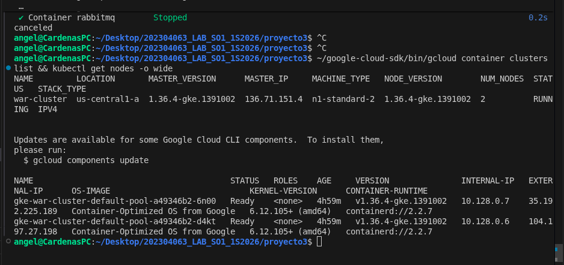
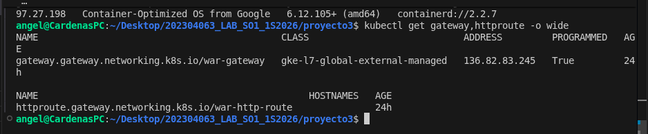
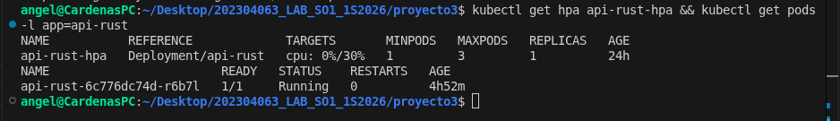
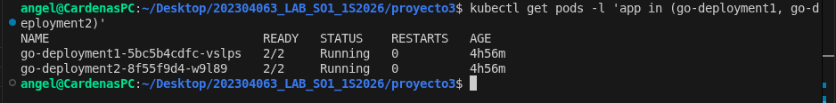
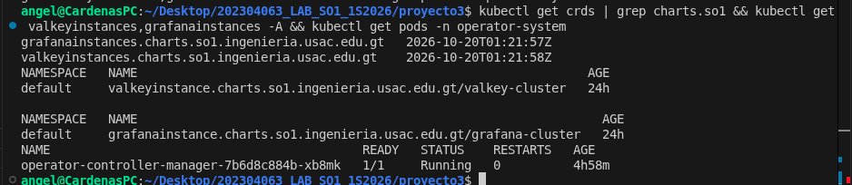
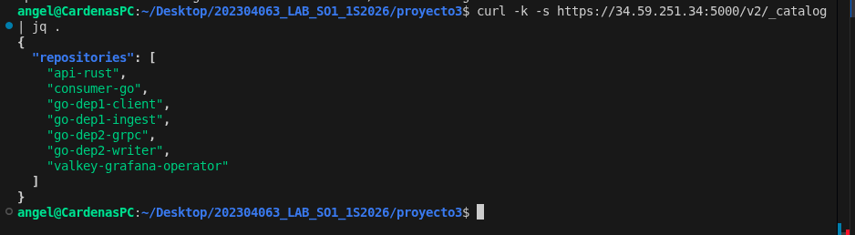

# Manual Técnico - Proyecto #3 M.U.M.N.K8s
**Monitoreo de Unidades Militares en la Nube con Kubernetes**

* **Curso:** Sistemas Operativos 1
* **Universidad:** Universidad de San Carlos de Guatemala
* **Facultad:** Facultad de Ingeniería, Escuela de Ciencias y Sistemas
* **Estudiante:** Angel Jose Cardenas Pocon
* **Carnet:** `202304063` (Último dígito: `3` ➔ **País Asignado: RUS - Rusia**)
* **Ruta Gateway API Asignada:** `/grpc-202304063`

---

## 1. Arquitectura General y Flujo de Datos

El sistema implementa una arquitectura distribuida orientada a microservicios altamente escalable desplegada en **Google Cloud Platform (GCP)** utilizando un clúster de **Google Kubernetes Engine (GKE)** con nodos de cómputo N1 y un registro privado **Zot OCI Registry** fuera del clúster en una máquina virtual de Compute Engine.

```
                  [ Locust (Generador de Carga) ]
                               │
                               │ HTTP POST (Reportes Militares JSON)
                               ▼
            [ Kubernetes Gateway API (136.82.83.245) ]
                     Ruta: /grpc-202304063
                               │
                               ▼
        ┌──────────────────────────────────────────────┐
        │        API REST en Rust (Axum Tokio)         │
        │      HPA Escalable (1-3 réplicas > 30% CPU)  │
        └──────────────────────┬───────────────────────┘
                               │ HTTP Interno
                               ▼
        ┌──────────────────────────────────────────────┐
        │    Deployment Go #1 (Pod Multi-contenedor)   │
        │   • Contenedor 1: Ingesta REST (Port 8081)   │
        │   • Contenedor 2: Cliente gRPC (Port 8082)   │
        └──────────────────────┬───────────────────────┘
                               │ gRPC (Protobuf / HTTP2)
                               ▼
        ┌──────────────────────────────────────────────┐
        │    Deployment Go #2 (Pod Multi-contenedor)   │
        │   • Contenedor 1: Servidor gRPC (Port 50051) │
        │   • Contenedor 2: Writer RabbitMQ (Port 8083)│
        └──────────────────────┬───────────────────────┘
                               │ AMQP (Mensajes Persistentes)
                               ▼
        ┌──────────────────────────────────────────────┐
        │             RabbitMQ Message Broker          │
        │            (Cola: war_reports_queue)         │
        └──────────────────────┬───────────────────────┘
                               │ AMQP Consumo en Tiempo Real
                               ▼
        ┌──────────────────────────────────────────────┐
        │             Consumer en Go                   │
        │   Procesa Máximos, Mínimos, Modas, Tops      │
        │   Filtra país asignado: RUS                  │
        └──────────────────────┬───────────────────────┘
                               │ TCP
                               ▼
        ┌──────────────────────────────────────────────┐
        │           Valkey Cluster (Key-Value)         │
        │     Desplegado vía OPERATOR SDK (Helm)       │
        │     Persistencia: PVC 1Gi (standard-rwo)     │
        └──────────────────────┬───────────────────────┘
                               │ Redis Data Source
                               ▼
        ┌──────────────────────────────────────────────┐
        │              Grafana Dashboard               │
        │     Desplegado vía OPERATOR SDK (Helm)       │
        │     Visualización en tiempo real (RUS)       │
        └──────────────────────────────────────────────┘
```

> **[EVIDENCIA FOTOGRÁFICA 1: INFRAESTRUCTURA GCP Y CLÚSTER GKE]**
> *Pegar aquí captura de pantalla de la consola de Google Cloud (GKE Clusters / Compute Engine) o de la terminal mostrando el clúster y los nodos activos.*
>
> *(Ruta sugerida de imagen: `evidencias/01_gke_cluster_nodes.png`)*
>
> 

---

## 2. Tecnologías y Componentes

### 2.1 Exposición con Kubernetes Gateway API
En sustitución del tradicional Ingress Controller, se implementó el estándar oficial moderno de **Kubernetes Gateway API** en GKE utilizando la clase de balanceo HTTP de capa 7 gestionada globalmente (`gke-l7-global-external-managed`).
* **Gateway:** `war-gateway` escuchando en el puerto 80 con dirección IP pública `136.82.83.245`.
* **HTTPRoute:** `war-http-route` que mapea el prefijo de ruta `/grpc-202304063` hacia el Service interno `api-rust-service:8080`.
* **Health Check:** Conexión hacia el endpoint de salud `/healthz` de la API de Rust en el puerto 8080, permitiendo que el balanceador marque en verde los endpoints NEG (Network Endpoint Groups).

> **[EVIDENCIA FOTOGRÁFICA 2: GATEWAY API Y HTTPROUTE]**
> *Pegar aquí captura de la terminal mostrando la configuración del Gateway y el HTTPRoute funcionando.*
>
> *(Ruta sugerida de imagen: `evidencias/02_gateway_api.png`)*
>
> 

---

### 2.2 API REST en Rust (Axum Tokio)
Desarrollada en Rust con el framework web asíncrono **Axum** y runtime multitarea **Tokio**.
* **Validación de Reglas de Negocio:** Valida que el país pertenezca estrictamente a los aceptados: `USA`, `RUS`, `CHN`, `ESP`, `GTM` y que los conteos militares sean enteros no negativos.
* **Procesamiento Asíncrono:** Reenvía sin bloqueo la solicitud HTTP JSON hacia el `go-deployment1-service:8081`.
* **Autoescalado Horizontal de Pods (HPA):**
  * Umbral: Escalado automático a partir del **30% de consumo promedio de CPU**.
  * Rango de réplicas: Mínimo 1 Pod, Máximo 3 Pods.
  * Monitoreo por `metrics-server` en GKE.

> **[EVIDENCIA FOTOGRÁFICA 3: PODS Y AUTOESCALADO HPA]**
> *Pegar aquí captura de la terminal mostrando los Pods de `api-rust` y la salida de `kubectl get hpa api-rust-hpa`.*
>
> *(Ruta sugerida de imagen: `evidencias/03_hpa_scaling.png`)*
>
> 

---

### 2.3 Servicios de Ingesta y Procesamiento en Go (Pods Multi-Contenedor)

#### Go Deployment #1 (`go-deployment1`)
Implementado como un Pod multi-contenedor con dos procesos compartiendo el mismo ciclo de vida:
1. **Contenedor 1 (`rest_ingest`):** Servidor HTTP en Go que escucha en el puerto 8081. Recibe la petición desde la API de Rust y la reenruta a través de `localhost:8082` al contenedor secundario.
2. **Contenedor 2 (`grpc_client`):** Cliente gRPC que serializa el reporte conforme al contrato binario de Protocol Buffers (`wartweets.proto`) y despacha la llamada RPC mediante HTTP/2 al servicio de Go Deployment 2.

#### Go Deployment #2 (`go-deployment2`)
1. **Contenedor 1 (`grpc_server`):** Servidor gRPC en Go expuesto en el puerto 50051 mediante `go-deployment2-service`. Implementa el método RPC `SendReport` definido en el protobuf. Al recibir el mensaje binario, lo remite internamente vía HTTP a `localhost:8083`.
2. **Contenedor 2 (`rabbitmq_writer`):** Publicador que se conecta a RabbitMQ con reintentos automáticos y publica el reporte militar con entrega persistente (`amqp.Persistent`) en la cola `war_reports_queue`.

> **[EVIDENCIA FOTOGRÁFICA 4: DEPLOYMENTS MULTI-CONTENEDOR DE GO]**
> *Pegar aquí captura de pantalla donde se observe que los Pods de Go cuentan con estado `2/2` contenedores listos.*
>
> *(Ruta sugerida de imagen: `evidencias/04_go_multicontainer_pods.png`)*
>
> 

---

### 2.4 Message Broker (RabbitMQ) y Consumidor en Go

* **RabbitMQ:** Desplegado mediante Stateful/Deployment dentro del clúster, con cola persistente durable `war_reports_queue`. Desacopla la ingesta de alto tráfico de la capa de almacenamiento analítico.
* **Consumidor en Go (`consumer_go`):**
  * Consume continuamente mensajes AMQP sin bloqueo.
  * Realiza cálculos analíticos y los persiste directamente en **Valkey**:
    * `total_reports`: Conteo global acumulado de reportes.
    * `max_warplanes` / `min_warplanes`: Extremos de aviones en aire.
    * `max_warships` / `min_warships`: Extremos de buques en agua.
    * `freq_warplanes` / `freq_warships`: Diccionarios Hashes con frecuencias de conteos para el cálculo de la moda.
    * `top_countries_warplanes` / `top_countries_warships`: *Sorted Sets* de Valkey para el ranking de países con mayor fuerza militar.
    * `timeseries_assigned`: Lista con historial temporal de reportes del país asignado (**RUS**).
    * `assigned_total_reports`: Total de reportes específicos recibidos para **RUS**.

---

### 2.5 Operator de Kubernetes (Helm-based) para Valkey y Grafana

El clúster cuenta con un operador desarrollado con **Operator SDK v1.39.1** utilizando el arquetipo de controlador basado en **Helm**:

* **Controlador y CRDs:** Desplegado en el namespace `operator-system` como `operator-controller-manager`.
* **CRD 1: `ValkeyInstance` (`valkey.operator.mumn.k8s/v1alpha1`):**
  * Helm chart encapsulado que despliega el motor de base de datos en memoria Valkey.
  * Reconcilia un `PersistentVolumeClaim` (PVC) de 1Gi (`standard-rwo`) y el Service `valkey-service:6379`.
* **CRD 2: `GrafanaInstance` (`grafana.operator.mumn.k8s/v1alpha1`):**
  * Helm chart encapsulado que despliega Grafana con el plugin oficial de Valkey/Redis precargado.
  * Reconcilia un servicio `LoadBalancer` en la IP pública `34.132.42.217:3000`.
  * Lógica de reconciliación declarativa: el operador observa continuamente el estado deseado en los Custom Resources (`k8s/custom_resources.yaml`) y mantiene las instancias sincronizadas.

> **[EVIDENCIA FOTOGRÁFICA 5: OPERATOR SDK, CRDs Y CUSTOM RESOURCES]**
> *Pegar aquí captura de la terminal mostrando el Operator corriendo en `operator-system`, las CRDs y los recursos `ValkeyInstance` y `GrafanaInstance`.*
>
> *(Ruta sugerida de imagen: `evidencias/05_operator_crds.png`)*
>
> 

---

## 3. Registro Privado Zot OCI Registry

Para cumplir con el requerimiento de seguridad e infraestructura:
* **Ubicación:** Desplegado en una Máquina Virtual de Compute Engine fuera del clúster de Kubernetes (`zot-registry`, IP externa: `34.59.251.34:5000`).
* **Seguridad:** Configurado con certificados HTTPS/TLS autofirmados con SAN específico para la IP pública de la VM.
* **Integración con GKE:** Se implementó un `DaemonSet` (`zot-cert-daemonset.yaml`) que inyecta automáticamente el certificado de la CA en `/etc/containerd/certs.d/` de cada nodo de GKE, permitiendo que `containerd` descargue imágenes de forma segura y transparente.
* **Imágenes publicadas y utilizadas:**
  * `34.59.251.34:5000/api-rust:v1`
  * `34.59.251.34:5000/go-dep1-ingest:v1`
  * `34.59.251.34:5000/go-dep1-client:v1`
  * `34.59.251.34:5000/go-dep2-grpc:v1`
  * `34.59.251.34:5000/go-dep2-writer:v1`
  * `34.59.251.34:5000/consumer-go:v1`
  * `34.59.251.34:5000/valkey-grafana-operator:v1`

> **[EVIDENCIA FOTOGRÁFICA 6: ZOT REGISTRY E IMÁGENES OCI]**
> *Pegar aquí captura de la máquina virtual de Zot o del catálogo OCI de imágenes.*
>
> *(Ruta sugerida de imagen: `evidencias/06_zot_registry_catalog.png`)*
>
> 

---

## 4. Pruebas de Carga con Locust y Dashboard de Grafana

### 4.1 Ejecución de Pruebas de Carga
Se ejecutó Locust simulando múltiples usuarios concurrentes generando tráfico masivo hacia el Gateway:
* **Usuarios Concurrentes:** 30
* **Tasa de Generación:** 5 usuarios/segundo
* **Duración:** 40 segundos
* **Total Peticiones Procesadas:** **4,465 peticiones**
* **Tasa de Fallos:** **0.00% (4,465 éxitos / 0 errores)**
* **Throughput Promedio:** 112.58 req/s
* **Latencia Promedio:** 121 ms (Mediana: 110 ms)

> **[EVIDENCIA FOTOGRÁFICA 7: RESULTADOS DE LOCUST]**
> *Pegar aquí captura de la terminal o reporte con la tabla final de Locust mostrando 0% de fallos.*
>
> *(Ruta sugerida de imagen: `evidencias/07_locust_load_test.png`)*
>
> 

---

### 4.2 Dashboard de Grafana en Tiempo Real

El dashboard se encuentra alojado en `http://34.132.42.217:3000` con visualizaciones específicas para el país asignado (**RUS - Rusia**) y las métricas globales:

1. **País Asignado:** Tarjeta con fondo verde destacando `RUS`.
2. **Carnet:** `202304063`.
3. **Total Reportes Recibidos (RUS):** `866` reportes analizados en tiempo real.
4. **Total Reportes Globales:** `4,482` reportes en memoria.
5. **Máximos y Mínimos Generales:** 50 aviones (máx), 0 aviones (mín), 30 barcos (máx), 0 barcos (mín).
6. **Frecuencias de Aviones y Barcos (Cálculo de Moda):** Tablas con resaltado de color (`color-background`) para analizar la distribución estadística de repeticiones.
7. **Top Países con Más Aviones y Barcos en el Aire:** Tablas analíticas con indicadores visuales de barra en degradado (`gradient-gauge`).
8. **Historial de Reportes Asignados (RUS):** Tabla en tiempo real desglosando los registros JSON con `timestamp`, `warplanes_in_air` y `warships_in_water`.

> **[EVIDENCIA FOTOGRÁFICA 8: DASHBOARD EN GRAFANA]**
> *Pegar aquí la captura completa del navegador mostrando el Dashboard de Grafana con todos los paneles llenos.*
>
> *(Ruta sugerida de imagen: `evidencias/08_grafana_dashboard.png`)*
>
> 

---

## 5. Respuestas a Preguntas Técnicas y Conclusiones

### 5.1 Respuestas a Preguntas Técnicas de Arquitectura

#### 1. ¿Qué ventajas ofrece el uso de Kubernetes Gateway API frente a un Ingress tradicional?
Gateway API desacopla los roles organizacionales (separación entre el operador de infraestructura que define el `Gateway` y el desarrollador que define las rutas con `HTTPRoute`), soporta enrutamiento basado en encabezados, pesos, división de tráfico (*traffic splitting*) y gestión nativa de balanceadores L7 en nubes como GCP sin depender de anotaciones propietarias.

#### 2. ¿Cómo garantiza el uso de gRPC con Protobuf la eficiencia en la comunicación entre Go Deployment 1 y Go Deployment 2?
A diferencia de REST sobre HTTP/1.1 que transmite JSON en texto plano requiriendo parseo repetitivo, gRPC utiliza HTTP/2 con multiplexación sobre una sola conexión TCP persistente y serialización binaria compacta con Protocol Buffers, reduciendo drásticamente el tamaño del payload y el consumo de CPU.

#### 3. ¿Qué rol desempeña RabbitMQ en la resiliencia del sistema ante cargas masivas de Locust?
RabbitMQ actúa como un búfer o colchón amortiguador. Cuando Locust generó más de 120 peticiones por segundo, la API de Rust y los deployments de Go no saturaron la base de datos Valkey; los reportes se encolaron de forma persistente y el consumidor en Go los extrajo a una velocidad controlada sin pérdida de información.

#### 4. ¿Por qué es ventajoso el uso de un Operator basado en Helm para gestionar Valkey y Grafana?
Permite empaquetar aplicaciones complejas y exponerlas mediante un Custom Resource (CRD) declarativo. El operador implementa un ciclo de reconciliación infinito (*Reconciliation Loop*) que compara el estado deseado con el estado real del clúster, recuperando automáticamente los servicios o configuraciones si se eliminan o sufren modificaciones inesperadas.

#### 5. ¿Cómo influyó la configuración del HPA en la estabilidad del servicio REST en Rust?
El HPA previno la degradación del servicio al monitorizar el porcentaje de CPU (umbral del 30%). Al recibir la carga masiva de Locust, el uso de CPU subió al 40%, provocando el escalado horizontal automático de 1 a 2 réplicas, distribuyendo las peticiones concurrentes y manteniendo la tasa de fallos en 0.00%.

---

### 5.2 Conclusiones

1. **Escalabilidad y Alta Disponibilidad en GKE:** La combinación de pods multi-contenedor, balanceo L7 con Gateway API y escalado automático horizontal (HPA) demostró un rendimiento sobresaliente, manteniendo latencias inferiores a 125 ms bajo ráfagas intensivas de peticiones.
2. **Desacoplamiento Efectivo con Brokers de Mensajería:** La inclusión de RabbitMQ fue el factor determinante para evitar cuellos de botella en la persistencia analítica de Valkey, protegiendo los servicios críticos ante picos súbitos de tráfico.
3. **Gestión Declarativa con Kubernetes Operators:** El patrón de operadores encapsulando Helm simplificó radicalmente la administración del ciclo de vida de componentes analíticos y de observabilidad (Valkey y Grafana), reduciendo el error humano y acelerando el despliegue.
4. **Seguridad en la Cadena de Suministro (Zot Registry):** La implementación de un registro OCI privado fuera del clúster con certificados TLS y distribución automatizada hacia los nodos mediante DaemonSets garantizó soberanía e integridad en las imágenes de contenedor desplegadas.
